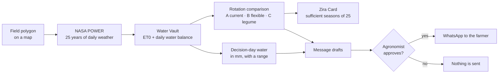
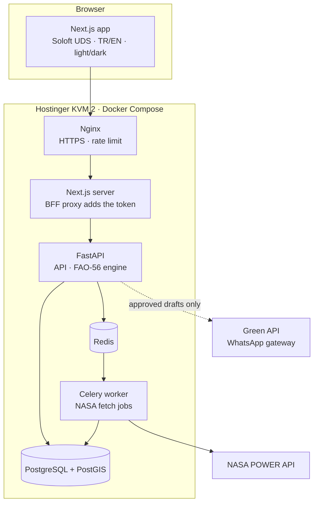

<p align="center">
  <picture>
    <source media="(prefers-color-scheme: dark)" srcset="frontend/public/brand/zira-logo-light.png">
    
  </picture>
</p>

<p align="center">
  <strong>Which crop rotation can this field's water carry?</strong><br>
  A decision-support tool for farmers and agronomists, built on NASA Earth observations.
</p>

<p align="center">
  <a href="https://zira.soloftindustries.com">Live demo</a> ·
  <a href="docs/PDT.md">Project Defining Document</a> ·
  <a href="docs/phases.md">Phases</a> ·
  <a href="docs/decisions/">Decisions</a> ·
  <a href="docs/runbook.md">Runbook</a>
</p>

> Built for the **NASA Space Apps Challenge 2026**, challenge
> *"Field Shift: Adapting Farms with NASA Data"*, and continued as a product by
> **Soloft Industries**.
>
> **Türkçe özet:** Zira, Konya Kapalı Havzası gibi su baskısı altındaki tarımsal bölgelerde
> ziraat mühendisine ve çiftçiye, ekimden önce "bu tarlanın suyu hangi rotasyonu taşır?"
> sorusunun cevabını veren bir karar destek aracıdır. NASA POWER verisinden tarlanın günlük
> su dengesini (FAO-56) hesaplar, üç rotasyonu aynı koşullarda karşılaştırır ve sonucu bir
> "Zira Kartı" olarak sunar. Ziraat mühendisi onaylamadan çiftçiye hiçbir mesaj gitmez.
> Zira karar vermez; mühendisin ve çiftçinin kararını destekler.

---

## Contents

1. [The problem](#the-problem)
2. [What Zira does](#what-zira-does)
3. [How it works](#how-it-works)
4. [NASA data](#nasa-data)
5. [The model](#the-model)
6. [WhatsApp messages with an approval step](#whatsapp-messages-with-an-approval-step)
7. [Where the project stands](#where-the-project-stands)
8. [Architecture](#architecture)
9. [Repository layout](#repository-layout)
10. [Running it locally](#running-it-locally)
11. [Configuration and parameters](#configuration-and-parameters)
12. [API](#api)
13. [Testing](#testing)
14. [Deployment](#deployment)
15. [Security and privacy](#security-and-privacy)
16. [Limits and honest caveats](#limits-and-honest-caveats)
17. [Documentation index](#documentation-index)
18. [Contributing and licence](#contributing-and-licence)

---

## The problem

In the Konya Closed Basin in Turkey groundwater keeps falling even in wet years, and sinkholes
(more than 740 are counted) follow. Fixed-calendar rotation plans, such as "wheat, then fallow",
ignore how much water the soil actually holds in a given year. A wet autumn and a dry autumn get
the same plan.

Zira asks a narrower, answerable question before sowing: **how much usable water does this
field's root zone hold on the decision day, and in how many of the past 25 seasons would a given
rotation have had enough?**

## What Zira does

Zira has three modules, each depending on the one before it:

| Module | Question it answers | Status |
| --- | --- | --- |
| **Field Memory** (Tarla Hafızası) | Was the field cropped or fallow in each of the last 10 years? | Planned (phase 5); needs Google Earth Engine access |
| **Water Vault** (Su Kasası) | How many millimetres of usable water does the root zone hold on a given day? | Built |
| **Zira Card** (Zira Kartı) | For each rotation, in how many of 25 seasons was the water enough? | Built, with provisional crop values |

Around them: field management with map polygons, a Data Center that shows what NASA data has
actually arrived, three roles (admin, agronomist, cooperative user), Turkish and English,
light and dark mode, and WhatsApp drafts that wait for an agronomist before reaching a farmer.

Zira **supports** a decision; it never makes one. Every card and message says so, and no
recommendation is final until an agronomist has signed off the values it rests on.

## How it works



1. **Add a field** by drawing its boundary on an OpenStreetMap map. PostGIS derives the centroid
   and the area; the soil texture sets the water the soil can hold.
2. **Fetch NASA POWER.** The backend downloads 2001–2025 daily data (9,131 days) for the field's
   centroid in a background job and caches it. The Data Center shows every fetch and its outcome.
3. **Read the Water Vault.** Pick a field, a crop and a date: Zira shows the usable water in mm,
   a low-to-high range, the daily storage and ET0 charts, and every assumption the number rests on.
4. **Compare rotations.** Strategies A, B and C run day by day over the same weather, soil and
   starting storage. Only the crop plan differs.
5. **Read the Zira Card.** Per strategy: sufficient seasons out of valid seasons with an
   uncertainty range, stress days, water deficit, irrigation need, and five fixed text fields
   (rationale, evidence, expected benefit, information gap, local review risk).
6. **Draft messages.** Events in the water balance become short WhatsApp drafts that an
   agronomist approves, edits or rejects.

## NASA data

| Source | Role in Zira | Used today |
| --- | --- | --- |
| **NASA POWER** (daily) | Temperature, humidity, wind, solar radiation, pressure and precipitation for ET0 and the water balance | **Yes**: the only data source the current model runs on |
| Landsat 8/9 | Field history: cropped or fallow (NDVI) | Planned (phase 5) |
| MODIS | Vegetation time series | Planned (phase 5) |
| GPM IMERG | Precipitation cross-check | Planned |
| SMAP | Regional surface soil moisture, a cross-check only | Planned |
| GRACE / GRACE-FO | Basin water storage context | Planned |

POWER is requested with `time-standard=UTC` explicitly (its default is local solar time),
`-999` is treated as missing, and wind measured at 10 m is converted to 2 m for ET0. Roles,
resolutions and scale warnings for each source are in
[`config/data_sources.yaml`](config/data_sources.yaml); the choice of POWER as the primary
precipitation source is [decision 0007](docs/decisions/0007-precipitation-source.md).

## The model

The engine implements the FAO Irrigation and Drainage Paper 56 method. The tests reproduce the
paper's own worked examples, so each equation is checked against printed numbers rather than
against itself.

- **Reference evapotranspiration:** FAO Penman-Monteith (Eq. 6 and its inputs). Example 18
  (Uccle, 6 July: 3.88 mm/day, every intermediate value) is a test.
- **Crop coefficient:** Kc curve (Eq. 66) with initial, development, mid and late stages.
- **Soil water:** total available water `TAW = 1000 (θFC − θWP) Zr`, readily available water
  `RAW = p · TAW`, stress coefficient `Ks`, and a daily root-zone balance with deep percolation.
- **Fallow:** with no crop the soil keeps a share (`fallow_efficiency`) of each day's rain up to TAW.
- **Uncertainty:** every result is computed three times, with the low, middle and high water range
  of the soil texture and the rain parameters shifted in the same direction. The card shows the
  middle result with its range.

### The three strategies

| | A: Current rotation | B: Water-dependent flexible rotation | C: Legume rotation |
| --- | --- | --- | --- |
| Rule | The user's current sequence, repeated (default: wheat, fallow) | On the decision day, sow the planned crop only if the Water Vault is at least half of TAW, otherwise leave it fallow | As A, but every second fallow year is sown with a legume |
| Why | The pattern the farmer knows; the baseline | The year's water, not the calendar, decides | Fixes nitrogen, shortens bare-field time |

All three start from the same storage and see the same weather, so the difference between them
is the result being measured. Fields are never ranked against each other on raw counts: each is
compared with **its own** current rotation.

A season counts as *water-sufficient* when seasonal actual ET divided by crop ET reaches
`sufficiency_ratio` (0.70) and, if set, stress days stay under a cap. Seasons with too many
missing weather days are excluded and reported.

Full specification: [`docs/PDT.md`](docs/PDT.md), sections 4 and 7.

## WhatsApp messages with an approval step

Zira writes a draft when something happens to a field's water; an agronomist approves it; only
then does it reach the farmer's phone.

| Event | What the message says |
| --- | --- |
| Autumn decision day | Usable water in mm against the sowing threshold, and what the rule says (four wordings: crop or fallow year, above or below the threshold) |
| Heavy rain (≥ 20 mm in a day) | How much fell and what the Water Vault holds now |
| Leaching (≥ 5 mm below the root zone) | Nitrogen can move down with the water; wait before fertilising |
| Water stress (5th and 15th stress day) | How many days the crop has been short of water |
| Harvest | Share of the possible water the crop received and whether the water was enough |
| Field card | The whole Zira Card in a few lines |

- Draft states: pending, approved, sent, rejected, failed. Only admins and agronomists can edit,
  approve or reject. Approving needs a recipient number.
- Sending uses [Green API](https://green-api.com) (free developer plan) from the server's own
  backend. Credentials come from `GREEN_API_INSTANCE_ID` and `GREEN_API_TOKEN`; without them
  approved drafts wait and **nothing is sent**.
- Wording and thresholds live in [`config/message_templates.yaml`](config/message_templates.yaml)
  in Turkish and English and need agronomist review.
- Green API drives a WhatsApp Web session of a real phone, which is not an official channel:
  use a dedicated number and low volume. Details and risks:
  [decision 0012](docs/decisions/0012-rotation-demo-and-whatsapp.md).

## Where the project stands

Work proceeds in phases, each one branch and one pull request
([`docs/phases.md`](docs/phases.md)).

| Phase | Scope | State |
| --- | --- | --- |
| 0. Repository skeleton | Monorepo, configuration from the parameter sheet, CI | Done |
| 1. Base infrastructure | FastAPI, 16-table schema, login and roles, Celery, Next.js shell on the Soloft design system | Done |
| 2. VPS deployment | Docker Compose, Nginx with HTTPS, memory limits, backups, runbook | Done, live |
| 3. Fields, NASA POWER, Data Center | Polygons, 25-year fetch with cache, jobs, Data Center | Done, live |
| 4. Water Vault | ET0, Kc, daily balance, uncertainty, screens | Done, live (decision-day water) |
| 5. Field Memory | Landsat/MODIS NDVI, cropped or fallow history | **Not started** (needs Earth Engine) |
| 6. Rotation and Zira Card | Strategies A, B, C, six metrics, card, WhatsApp drafts | Done with **provisional crop values**, live |
| 7. Sensors and cooperative | Sensor ingest, simulator, cooperative panel, farmer view | **Not started** |

Water Vault was built before Field Memory because it needs only NASA POWER
([decision 0003](docs/decisions/0003-phase-order.md)).

## Architecture



| Layer | Technology |
| --- | --- |
| Backend | Python 3.12, FastAPI, SQLAlchemy 2, Alembic, GeoAlchemy2, Pydantic, httpx, Argon2, JWT |
| Data | PostgreSQL 17 with PostGIS, Redis 7 |
| Jobs | Celery workers on Redis |
| Frontend | Next.js 16 (App Router), React, next-intl, Leaflet with OpenStreetMap tiles |
| Design system | `@soloft/uds` (private; an external dependency, never embedded) |
| Infrastructure | Docker Compose, Nginx, Let's Encrypt, GitHub Actions |

Design choices worth knowing:

- **The browser never holds the API token.** Sign-in sets an httpOnly cookie; a Next.js route
  (`/api/backend/*`) adds the token and only forwards an allowlist of API roots
  ([decision 0008](docs/decisions/0008-sign-in-and-sessions.md)).
- **Model values live in `config/`, not in code**, and the backend refuses to start if they are
  malformed. No field coordinate is hard-coded anywhere.
- **Heavy work runs in workers.** A NASA fetch never happens inside a request.
- **Who sees which field** is enforced in the API: admins and agronomists see all fields, a
  cooperative user sees their organization's, anyone else gets a 404
  ([decision 0010](docs/decisions/0010-field-access-and-map.md)).

## Repository layout

| Path | Contents |
| --- | --- |
| [`backend/`](backend/) | FastAPI application: `app/api` routers, `app/services/water` (FAO-56 engine, rotation), `app/services/messaging` (drafts, Green API), `app/models`, `migrations/`, `tests/` |
| [`frontend/`](frontend/) | Next.js application: pages under `app/[locale]/(console)`, components, translations in `messages/` |
| [`config/`](config/) | Parameters, crops, soils, climate profiles, data sources, provisional rotation values, message templates |
| [`docs/`](docs/) | PDT, phase plan, decisions 0001–0012, runbook |
| [`infra/`](infra/) | Development and production Compose files, Nginx, backup and deploy scripts |
| [`simulator/`](simulator/) | Sensor simulator (phase 7) |
| [`.github/workflows/`](.github/workflows/) | CI and image build |

## Running it locally

Requirements: Docker with Compose, Python 3.12+ with [uv](https://docs.astral.sh/uv/),
Node.js 22.12+, and read access to the private `SerdarOklu/soloft-uds` repository
(see [frontend/README.md](frontend/README.md)).

```bash
cp .env.example .env

# 1. database and job queue
docker compose --env-file .env -f infra/docker-compose.dev.yml up -d

# 2. backend
cd backend
uv sync
uv run alembic upgrade head                 # create the tables
uv run python -m app.cli seed-reference     # crops and data sources from config/
uv run python -m app.cli create-user --email you@example.com --name "Your Name" --role admin
uv run uvicorn app.main:app --reload        # http://localhost:8000/docs

# 3. frontend, in a second terminal
cd frontend
npm ci
npm run dev                                 # http://localhost:3000

# 4. job worker, in a third terminal (needed to fetch NASA data)
cd backend
uv run celery -A app.tasks.celery_app worker --loglevel INFO   # on Windows add: --pool=solo
```

Sign in at <http://localhost:3000>, add a field, fetch its NASA data from the field page, then
open **Water Vault**, **Rotation and Zira Card** and **WhatsApp messages**.

With `make` installed: `make dev-up`, `make migrate`, `make seed`, `make backend-run`,
`make frontend-dev`, `make worker`, `make check`.

There is no self-registration; staff create accounts with the `create-user` command.

## Configuration and parameters

Environment variables are documented in [`.env.example`](.env.example) (development) and
[`.env.prod.example`](.env.prod.example) (production). The ones that matter most:

| Variable | Purpose |
| --- | --- |
| `DATABASE_URL`, `REDIS_URL` | PostgreSQL and Redis |
| `SECRET_KEY` | Signs access tokens; production refuses a short or placeholder value |
| `POWER_BASE_URL` | NASA POWER endpoint |
| `GREEN_API_INSTANCE_ID`, `GREEN_API_TOKEN` | WhatsApp gateway; leave empty to keep sending off |

Model values live in [`config/`](config/) and mirror the project's parameter sheet, the source of
truth. Each parameter has a status:

- `set`: usable.
- `needs_signoff`: a team assumption, **usable for demos only** until an agronomist confirms it.
- `to_be_set`: no value yet; an analysis that needs it must refuse to run.
- `optional`.

`GET /api/v1/meta` lists what is still open on a running system, and screens that depend on
unsigned values say so. See [config/README.md](config/README.md).

## API

Interactive documentation is served at `/docs` by the backend. The main endpoints:

| Endpoint | Purpose |
| --- | --- |
| `POST /api/v1/auth/login`, `GET /api/v1/auth/me` | Sign in; the current user |
| `GET/POST /api/v1/fields`, `GET/DELETE /api/v1/fields/{id}` | Fields from a GeoJSON polygon |
| `POST /api/v1/fields/{id}/weather/fetch` | Queue a NASA POWER fetch (202 with the job) |
| `GET /api/v1/fields/{id}/weather/summary` | Coverage, yearly totals, latest days, latest job |
| `GET /api/v1/data-center/sources`, `/jobs` | What NASA data arrived and how (admin, agronomist) |
| `GET /api/v1/fields/{id}/water-vault?crop=&date=` | Usable water in mm with a range, the daily series and assumptions |
| `GET /api/v1/fields/{id}/rotation?rotation=` | Strategies A, B and C over the stored record |
| `POST /api/v1/fields/{id}/messages/generate` | Write WhatsApp drafts for a season |
| `GET /api/v1/messages`, `PATCH`, `POST .../approve`, `.../reject`, `.../send` | The approval queue |
| `GET /api/v1/reference/soils`, `/reference/crops` | Reference data from `config/` |

Refusals carry a machine-readable `code` (for example `no_weather_data` or `season_outside_record`)
that the interface turns into a sentence in the user's language.

## Testing

```bash
cd backend && uv run ruff check . && uv run ruff format --check . && uv run pytest
cd frontend && npm test && npm run typecheck && npm run build
```

| Area | Tests |
| --- | --- |
| Backend | 184 tests: FAO-56 worked examples (ET0, Kc, TAW/RAW, the ten-day stress table), hand-worked API numbers on PostgreSQL, rotation engine, message events and the approval flow with a recording gateway, migrations |
| Frontend | 38 tests: proxy allowlist, role menus, formatting, translation parity between Turkish and English |

Backend tests that need PostgreSQL or Redis skip locally when those are not running and are never
allowed to skip in CI. The database tests drop and rebuild the schema of `TEST_DATABASE_URL`;
never point it at a database you want to keep.

## Deployment

Production runs on a single Hostinger KVM 2 VPS (2 vCPU, 8 GB RAM) with Docker Compose: Nginx
(HTTPS from Let's Encrypt), frontend, backend, worker, PostgreSQL with PostGIS and Redis, each
with a memory limit ([decision 0006](docs/decisions/0006-vps-resource-budget.md)). Images are
tagged per phase so the previous build stays on the server for a rollback. Step-by-step
instructions, backups, restore and certificate renewal are in [docs/runbook.md](docs/runbook.md).

## Security and privacy

- Passwords are hashed with Argon2; access tokens are short-lived JWTs kept in an httpOnly cookie.
- The login endpoint is rate limited at Nginx; only Nginx is exposed to the internet.
- Roles are enforced in the API, not only hidden in the interface.
- Production refuses to start with a placeholder or short `SECRET_KEY`.
- Phone numbers are stored only on message drafts and the API returns only the last four digits.
- The WhatsApp gateway token is never logged or returned in a response.

## Limits and honest caveats

Read these before relying on any number:

- **The crop season uses provisional values.** Stage lengths, sowing dates, irrigation
  efficiency and the legume in strategy C (lentil) are FAO-56 Table 11 starting values in
  [`config/rotation_demo.yaml`](config/rotation_demo.yaml), not signed off by an agronomist, and
  likely off for Konya's colder climate. Cards and messages say so.
- **Strategy A is typed in, not observed.** Field Memory (phase 5) is not built, so the current
  rotation comes from the user, not from satellite history.
- **24 seasons, not 25.** The 2001–2025 record holds 24 complete winter seasons.
- **The weather is regional.** POWER is a gridded value, not a measurement on the field, and
  there is no sensor correction yet, so the uncertainty range is shown wide.
- **Several parameters await sign-off** (rain share, fallow efficiency, sufficiency ratio, the
  strategy B threshold and others). The screens list the ones a result depends on.
- **Crop recommendations are not final.** No rotation or crop is a firm recommendation until an
  agronomist confirms it.
- **WhatsApp through Green API is unofficial** and can lead to the sending number being blocked.
- Fonts are still loaded from Google Fonts; self-hosting them is
  [decision 0009](docs/decisions/0009-self-hosted-fonts.md), open.

## Documentation index

| Document | What it holds |
| --- | --- |
| [`docs/PDT.md`](docs/PDT.md) | Scope, architecture, calculation specification, data model, API, tests |
| [`docs/phases.md`](docs/phases.md) | Phases, approval criteria, differences from the PDT |
| [`docs/decisions/`](docs/decisions/) | Twelve decisions, including those still open |
| [`docs/runbook.md`](docs/runbook.md) | Deploying and operating the VPS |
| [`backend/README.md`](backend/README.md) | Backend commands, endpoints, layout |
| [`frontend/README.md`](frontend/README.md) | Frontend commands and the design-system rules |
| [`config/README.md`](config/README.md) | Parameter statuses and how to change a value |
| [`infra/README.md`](infra/README.md) | Compose files and scripts |

## Contributing and licence

Each phase is one branch and one pull request, and work stops at the end of a phase until it is
reviewed. Model values change in the parameter sheet, the matching `config/` file and the tests
together. The Soloft design system (`@soloft/uds`) is an external dependency and is never modified
from this repository.

Licence: not decided yet.
