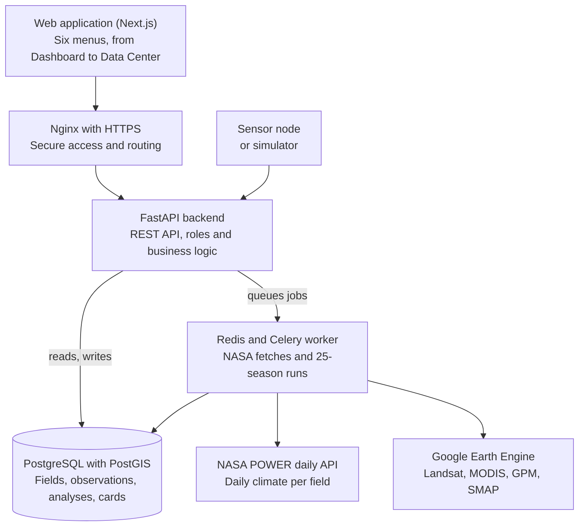

# Zira PDT (Project Defining Document)

Snapshot of 14 November 2026, exported from the living document. The parameter sheet named in section 8 is mirrored in [`config/`](../config/README.md).

## 1. Purpose and scope

Zira is a decision-support platform that tells an agronomist, before sowing, which crop rotation a specific field's water can carry. It combines NASA Earth observations with the field's own soil, crop and farmer data, and it supports the agronomist's and farmer's judgment without replacing it.

- **Problem.** In the Konya Closed Basin groundwater keeps falling despite wet years, and the Zira summary counts more than 740 sinkholes. Fixed-calendar rotation plans ignore how much water the soil holds in a given year.
- **Users.** Primary users are agronomists and cooperatives. The farmer receives the result as a plain-language card over WhatsApp.
- **Three modules.** Field Memory (Tarla Hafızası): was the field cropped or fallow in each of the last 10 years. Water Vault (Su Kasası): how many millimetres of usable water the soil holds on the decision day. Zira Card (Zira Kartı): for each rotation, in how many of 25 seasons the water was enough.
- **Product decision.** "Single demo, multi-field architecture": the first proof runs on one real Konya field under identical conditions, while location, soil, crop, irrigation, farmer priorities and data quality are variable per field from day one.
- **Context.** The project answers the NASA Space Apps 2026 challenge "Field Shift: Adapting Farms with NASA Data" and continues afterwards as a product hosted on a VPS.

| In scope for version 1 | Out of scope for version 1 |
| --- | --- |
| One real demo field in the Konya Closed Basin, then two validation fields in the same basin | Supporting every farming region at once; other climates need local calibration first |
| Three rotation strategies compared under identical starting conditions | Automatic advice sent to farmers without agronomist review |
| NASA POWER, Landsat 8/9, MODIS, GPM, SMAP; GRACE as basin context | Reinforcement learning or other advanced ML |
| Rule-based, explainable water balance and decision logic | 3D digital twin |
| Shareable card (image or PDF) sent manually over WhatsApp | Fully automated WhatsApp Business API delivery |
| Sensor data interface and a sensor simulator | Physical sensor hardware deployment |

This document consolidates the six source documents listed in section 16. Where they disagree, the decisions recorded in section 15 apply.

## 2. Challenge requirements

The challenge asks for a decision-support tool that helps farmers explore crop rotations using NASA Earth observations together with local soil, crop characteristics and farmer priorities. The requirements below come from a participating team's [README summary](https://github.com/hendrixxD/FieldDynamics-Lab), because the official challenge page could not be read automatically; check them against the official text.

| Requirement | How Zira meets it | Acceptance check |
| --- | --- | --- |
| Use NASA Earth observation data | POWER, Landsat, MODIS, GPM, SMAP feed the three modules (section 6) | Data Center shows a successful fetch per source with date, version and resolution |
| Combine with local soil, crop and farmer priorities | Field Profile holds soil, crop, irrigation, constraints and priorities (section 5) | An analysis cannot run without a complete Field Profile |
| Compare at least three rotations, one being the farmer's current one | Strategies A, B and C (section 4.4) | Card shows all three side by side for the same field |
| For each strategy: rationale, evidence, benefits, information gaps, risks needing local review | Five fixed fields on every strategy block of the card | No strategy block renders with an empty field |
| Show bare-field periods, most vulnerable seasons, pest-cycle breaks | Field Memory shows fallow and bare periods; Water Vault shows stress days in critical stages | Screens list them per season |
| Farmer inputs: water, equipment, market constraints | Farmer constraint form | Changing a constraint changes the card |
| Explain uncertainty and where human judgment matters | Uncertainty range on every result; wider without a sensor | Range is visible and labelled on the card |
| Plain-language explanations of NDVI, evapotranspiration, soil moisture anomaly | Glossary in the interface and on the card | Glossary reachable from every screen that uses a term |
| Explain satellite versus ground data | Water Vault shows the satellite and sensor difference | Text and chart present on the Water Vault screen |
| State that the tool supports, not replaces, farmer judgment | Fixed statement on card and interface | Statement present on every card |

Submission closes on Nov 15, 2026 at 23:59 local time ([Space Apps 2026](https://www.spaceappschallenge.org/2026/)). The same README lists these submission rules, to be confirmed in the official Project Submission Guide:

- A demo of at most 30 seconds of video or at most 7 slides; exceeding the limit removes the project from global judging.
- A public repository link for the code; all links public and working.
- A clear list of the NASA and partner datasets used.
- Every required field on the project page completed and the terms box ticked.

Judging in 2025 used five criteria: impact, creativity, validity, relevance and presentation ([Project Submission Guide](https://www.spaceappschallenge.org/resources/project-submission-guide/)).

## 3. System architecture

Zira is a responsive web application on a single VPS: the user interface never talks to NASA directly, and every slow data job runs in a background worker. Fetching 25 years of data does not have to finish in seconds; the user follows the job in the Data Center.



Requests go down the stack to the backend, which reads and writes the database and queues slow work; the worker calls NASA POWER and Earth Engine and writes results back to the database.

| Layer | Technology | Responsibility |
| --- | --- | --- |
| Frontend | React or Next.js, responsive | Six-menu web app: Dashboard, Fields, Field Memory, Water Vault, Rotation and Zira Card, Data Center |
| Edge | Nginx with HTTPS | Secure access, routing to frontend and API |
| Backend | Python, FastAPI | REST API, business logic, authentication and roles |
| Database | PostgreSQL with PostGIS | Fields, polygons, observations, analyses, cards |
| Job queue | Redis with Celery workers | NASA fetches, Earth Engine processing, water balance and rotation runs |
| Remote sensing | Google Earth Engine | Landsat, MODIS, GPM, SMAP processing over the field polygon |
| Climate data | NASA POWER daily API | Daily meteorology and radiation per field point |
| Deployment | Docker Compose | One compose file for all services on the VPS |

These are the recommended starting choices from the VPS architecture report, compatible with the existing Python data-integration code; they are not mandatory.

**Three architecture rules.**

1. **No coordinate in code.** Every analysis reads location, soil, crop and management from the Field Profile of the field being analysed.
2. **Geometry in PostGIS.** Field points and polygons are stored as PostGIS geometry so each field can be mapped to the NASA grid cell or pixels it intersects.
3. **Every analysis is reproducible.** Each run stores the data version, date range, resolution and model version it used, so an old Zira Card can be re-examined later.

**Proposed repository layout.**

```text
zira/
  backend/
    app/api/            # FastAPI routers
    app/models/         # SQLAlchemy models
    app/schemas/        # request and response schemas
    app/services/
      power.py          # NASA POWER client and cache
      gee.py            # Earth Engine queries (Landsat, MODIS, GPM, SMAP)
      et0.py            # FAO Penman-Monteith
      water_balance.py  # daily root-zone balance
      field_memory.py   # NDVI series, cropped or fallow classification
      rotation.py       # strategies A, B, C and comparison
      card.py           # Zira Card assembly and export
    app/tasks/          # Celery tasks
    app/core/           # config, auth, parameters
    tests/
  frontend/
  infra/                # docker-compose.yml, nginx config
  docs/
```

**Configuration (environment variables).** `DATABASE_URL`, `REDIS_URL`, `SECRET_KEY`, `POWER_BASE_URL`, `EE_SERVICE_ACCOUNT`, `EE_PRIVATE_KEY_PATH`, `MODEL_VERSION`. API keys and configuration are editable by the admin in system settings and never committed to the repository.

## 4. Functional modules

Six modules map one-to-one to the six menus. Each depends on the one before it: no Water Vault without NASA data, no rotation comparison without the Water Vault.

### 4.1 Fields (field management)

Every field is an independent record with its own Field Profile (section 5).

- **New field form:** name, latitude and longitude, boundary drawn on a map, area in hectares, soil type, rainfed or irrigated, crop and variety, sowing and harvest periods, irrigation details.
- **Field detail page:** header (for example "Konya Demo Field 001, 12 ha, wheat, rainfed"), status of each analysis (field history, water analysis), links to the three modules.
- **Rule:** a weather-station coordinate is never used as a field.

### 4.2 Field Memory (Tarla Hafızası)

Reconstructs whether the field was cropped or fallow in each of the last 10 seasons, from Landsat with MODIS as support.

| Item | Specification |
| --- | --- |
| Inputs | Field polygon; Landsat 8 and 9 surface reflectance; MODIS NDVI; `history_years` |
| Processing | Apply scale and offset to bands; mask cloud and shadow with `QA_PIXEL`; compute NDVI per scene; take polygon-interior statistics; build a seasonal series; classify each season as cropped or fallow against `ndvi_cropped_threshold`; fill cloudy gaps with MODIS |
| Outputs | Per season: class (cropped, fallow, unknown), confidence level, number of valid scenes, number of pixels |
| Screen | 10-year NDVI time series with season chart; likely cropped and fallow periods; warnings for cloudy or missing imagery; a confirmation field where the user or agronomist corrects the history |
| Limits | NDVI alone does not identify the crop species; the crop is entered or confirmed by the farmer or agronomist. Small or narrow parcels have few pixels and mixed edges |

The confirmed sequence of the last 10 seasons is strategy A, the farmer's current rotation.

### 4.3 Water Vault (Su Kasası)

Computes the daily root-zone water balance and reports the usable water in millimetres on the decision day.

| Item | Specification |
| --- | --- |
| Inputs | Daily weather (POWER), precipitation (section 6 decides the source), soil profile, crop parameters, irrigation input, sensor readings if present |
| Processing | Reference evapotranspiration, crop evapotranspiration, daily balance with stress (section 7) |
| Outputs | Per day: precipitation, effective precipitation, irrigation, ET0, ETc, actual ET, storage in mm, stress coefficient; per decision day: usable water in mm with an uncertainty range |
| Screen | Precipitation, soil moisture, irrigation input; ET0, ETc, usable water; satellite versus sensor difference and data confidence; date picker that shows the water balance on any past date |
| Limits | POWER does not measure the field's root-zone water. SMAP is a regional surface value on a pixel of about 9 km. Without a sensor the uncertainty range is shown wider |

### 4.4 Rotation and Zira Card

Runs three strategies over 25 seasons on the same field with the same weather series, soil profile, starting soil water, season definition, irrigation assumption and farmer priorities. Only the rotation changes.

|  | A: Current rotation | B: Water-dependent flexible rotation | C: Legume rotation |
| --- | --- | --- | --- |
| Definition | The confirmed sequence from Field Memory (example: wheat, fallow) | On each decision day, sow if the Water Vault is above the threshold, otherwise fallow | Chickpea or lentil in a share of the fallow years |
| Rationale | The pattern the farmer knows; the baseline | The year's water, not the calendar, decides | Fixes nitrogen, shortens bare-field time |
| Evidence | Landsat and MODIS vegetation history | Soil moisture, precipitation, 25-season balance | 25-season balance with the legume's water need |
| Expected benefit | Known risk, no new equipment | No wasted sowing or irrigation in dry years | Nitrogen, organic matter, extra income |
| Information gap | Satellite separates cropped from fallow, not crop species | Coarse satellite soil moisture where no sensor exists | Local yield and market price |
| Local review risk | Farmer must confirm the crop sequence | Threshold must be calibrated to soil type | Variety's tolerance to cold and disease |

The crop names are design proposals. No rotation or crop is shown as a firm recommendation until an agronomist has confirmed it.

**Metrics reported per field and strategy.**

| Metric | Meaning |
| --- | --- |
| Water-sufficient seasons out of valid seasons | Share of seasons that meet the defined water-stress criterion |
| Stress days in the critical period | Water stress during sensitive stages such as flowering and grain fill |
| Seasonal water deficit (mm) | Crop water need that was not met |
| Irrigation need (mm) | Extra water required under the stated assumptions |
| Uncertainty range | Effect of missing data or parameters on the result |
| Difference from current rotation | Change of the alternative against the same field's baseline |

Fields are never ranked against each other on raw counts: 18 of 25 on one field is not "better" than 14 of 25 on another. Each field is reported against its own current rotation, together with its data confidence.

**Zira Card content.** Selected field; for each strategy: in how many of 25 seasons the water was enough, why it is proposed, which data it rests on, the expected benefit, what information is missing, what the agronomist must check; the uncertainty range; the statement that Zira supports and does not replace the decision; data and model version.

### 4.5 Dashboard

Lets a user grasp the state of the system in ten seconds; no analysis happens here. It shows total registered fields, last NASA data update, average precipitation for the selected period and region, soil moisture from the current source, completed and pending analyses, alerts (missing data, sensor fault, risk), and a map of field locations below.

### 4.6 Data Center

A technical view for admins and the technical team that proves NASA data really arrives and is processed. It shows, for POWER, Landsat, MODIS, SMAP, GPM and GRACE: connection status, last successful fetch, missing or faulty records, API error logs, and each source's version, resolution and date range. It also holds the fetch history.

## 5. Location and parameter architecture

One shared analysis engine runs for every field; everything that differs between fields lives in a Field Profile object, never in code. NASA sources are queried per field by its point or polygon, or mapped to the grid cell it falls in.

### 5.1 Field Profile

| Group | Fields stored per field | Source and status |
| --- | --- | --- |
| Identity and geometry | `field_id`, polygon, coordinate system, area (ha), centre coordinate, elevation | User and map; required |
| Soil | Texture, clay, sand and silt shares, organic matter, field capacity, wilting point, effective soil depth, infiltration and drainage | Soil analysis or local data; flagged as uncertain when missing |
| Crop | Species and variety, sowing and harvest dates, growth stages, Kc curve, root depth | Agronomist or crop database |
| Climate | Precipitation, minimum and maximum temperature, humidity, wind, radiation, ET0 | NASA POWER and GPM; source and period recorded |
| Satellite observation | NDVI, image date, cloud and quality mask, pixel count | Landsat and MODIS |
| Irrigation and management | Rainfed or irrigated, method, amount, application efficiency, previous crop or fallow | Farmer, cooperative or field record |
| Constraints and preferences | Water, equipment, market; priority order | Farmer form |
| Data quality | Source, product version, resolution, unit, date, quality flag, gaps | Recorded automatically by the system |

```json
{
  "field_id": "ZIRA_FIELD_001",
  "name": "Konya Demo Field 001",
  "region": "Konya Closed Basin",
  "geometry": {"type": "Polygon", "coordinates": "to be set"},
  "centroid": {"lat": null, "lon": null},
  "area_ha": null,
  "elevation_m": null,
  "soil": {"texture": null, "theta_fc": null, "theta_wp": null, "taw_mm_per_m": null, "effective_depth_m": null},
  "management": {"water_regime": "rainfed", "irrigation_method": null, "irrigation_efficiency": null},
  "crop_cycles": [{"season": "2025-2026", "crop": "winter_wheat", "sowing": null, "harvest": null}],
  "constraints": {"water": null, "equipment": null, "market": null},
  "priorities": ["water_use", "nitrogen_fixing", "market_fit", "erosion", "organic_matter", "forage_value"],
  "sensor": {"present": false, "depths_cm": [10, 30, 60, 100]}
}
```

### 5.2 What changes when the field changes

| Factor | Parameters that must change | Risk if done wrong |
| --- | --- | --- |
| Location and polygon | Geometry, area, coordinate, elevation, source pixel | A neighbour's field or the wrong grid cell is assigned |
| Soil | Texture, field capacity, wilting point, root depth, infiltration, drainage | The Water Vault runs on the wrong capacity |
| Crop and variety | Sowing and harvest dates, growth stages, Kc, root depth, stress sensitivity | Crop water need is miscalculated |
| Irrigation | Rainfed or irrigated, amount, method, timing, efficiency | Rain-dependent risk looks lower or higher than it is |
| Management | Previous crop, fallow, equipment, market constraint, calendar | The proposal is one the farmer cannot carry out |
| Farmer priority | Order of water, forage value, nitrogen fixing, erosion, organic matter, market | The system optimises the wrong goal |
| Sensor and data quality | Sensor depth, calibration, measurement date, satellite quality flags | Uncertainty is shown lower than it is |

### 5.3 Same conditions and different conditions

Both are needed and they come in sequence: identical conditions measure which rotation is better; different conditions show whether Zira transfers to other fields.

| Test approach | Held constant | Changed | What it proves |
| --- | --- | --- | --- |
| Same field, same conditions | Location, polygon, weather series, starting soil water, soil profile, crop season, management assumptions | Rotation strategy only | A fair comparison of rotations |
| Same field, changing scenario | Field and base data | Irrigation limit, farmer priority or climate scenario, one factor at a time | Under which condition the decision changes |
| Same basin, different fields | Engine, period, methodology | Polygon, soil, irrigation, crop, microclimate | The same engine fits different fields |
| Different climate region | Software and reporting standard | Climate, calendar, soil and crop profile | Regional generalisation; needs further validation |

The three simulations start from the same soil water. On later days each rotation's consumption and storage diverge; that difference is the result being measured and is never equalised artificially. Crop-specific coefficients differ by crop; the data source and calculation method stay the same.

When moving to another region, thresholds and Kc values are not copied; local soil, crop and climate calibration is done first.

## 6. Data sources and integration

Sources are connected in order, not all at once: NASA POWER first, then Landsat, then GPM and SMAP, then MODIS and GRACE. Resolutions below are approximate and must be confirmed per product version; regional data is never presented as a direct measurement of one field.

| Source | Role in Zira | Approx. resolution | Access | Priority | Scale warning |
| --- | --- | --- | --- | --- | --- |
| NASA POWER | Daily climate inputs and long-term meteorology and radiation history | Varies by parameter; roughly 50 km | POWER daily API | First | Each parameter keeps its source product's native resolution; store API metadata |
| Landsat 8/9 | 10-year vegetation pattern inside the field polygon | 30 m | Earth Engine `LANDSAT/LC08/C02/T1_L2`, `LANDSAT/LC09/C02/T1_L2` | First | Few pixels and mixed edges on small parcels; cloud mask and polygon-interior statistics are mandatory |
| GPM IMERG | Precipitation series; cross-check for POWER precipitation | 0.1 degree, about 10 km; half-hourly | Earth Engine `NASA/GPM_L3/IMERG_V07` | High | Fields in the same pixel are not separate rain observations |
| SMAP | Recent regional surface soil moisture; check for model and sensor | About 9 km | Earth Engine `NASA/SMAP/SPL3SMP_E/006` (after 4 December 2023) and `/005` (earlier) | High | Not field scale; surface only; mission began in 2015, so it cannot cover 25 seasons |
| MODIS | Regional phenology; support for cloudy Landsat periods | 250 m, 16-day composite | Earth Engine `MODIS/061/MOD13Q1` | Medium | Does not replace Landsat on small fields |
| GRACE / GRACE-FO | Basin-scale total water storage trend | About 300 km, monthly | Collection to be selected | Medium | Total terrestrial water storage, not the parcel's groundwater or soil moisture |
| ECOSTRESS | Evapotranspiration support | 70 m | Collection to be selected | Optional | Not needed for the first working demo |
| SRTM | Elevation and slope | 30 m | Collection to be selected | Optional | Not needed for the first working demo |

### 6.1 NASA POWER request

```text
GET https://power.larc.nasa.gov/api/temporal/daily/point
  parameters=PRECTOTCORR,T2M,T2M_MAX,T2M_MIN,RH2M,WS10M,PS,ALLSKY_SFC_SW_DWN
  community=AG
  latitude=<field centroid>
  longitude=<field centroid>
  start=20010101
  end=20251231
  format=JSON
  time-standard=UTC
```

| POWER parameter | Meaning | Unit | Use in Zira | Database column |
| --- | --- | --- | --- | --- |
| `PRECTOTCORR` | Corrected precipitation | mm/day | Water input | `precipitation_mm` |
| `T2M` | Mean temperature at 2 m | °C | Climate class, ET0 | `temperature_avg` |
| `T2M_MAX` | Maximum temperature | °C | Heat risk, ET0 | `temperature_max` |
| `T2M_MIN` | Minimum temperature | °C | Frost risk, ET0 | `temperature_min` |
| `RH2M` | Relative humidity at 2 m | % | ET0 | `humidity` |
| `WS10M` | Wind speed at 10 m | m/s | ET0 after conversion to 2 m | `wind_speed` |
| `ALLSKY_SFC_SW_DWN` | Solar radiation at the surface | MJ/m²/day | ET0 | `solar_radiation` |
| `PS` | Surface pressure | kPa | ET0 | `surface_pressure` |

- **Verify before first run:** each parameter's availability, unit and resolution for the AG community in the POWER parameter catalogue. The radiation and pressure units above are not stated in the source reports.
- **Response handling:** read `properties.parameter`; index by date (`YYYYMMDD`); convert to numeric; replace `-999` with missing; request timeout 60 s; raise on HTTP errors and on an unexpected format.
- **Caching:** NASA warns that repeated requests for the same grid cell can be blocked. Store every response; never refetch a date range already held. Keep the raw API response as well as the cleaned rows.
- **Metadata:** store source product, spatial resolution, unit and time standard for each parameter.
- **Seasons:** 2001 to 2025 is 25 calendar years used to test the connection. The 25 seasons are built from crop seasons (sowing to harvest), not calendar years.

### 6.2 Landsat processing

```text
SR   = DN × 0.0000275 - 0.2          (Collection 2 scale and offset)
NDVI = (NIR - Red) / (NIR + Red)     (Landsat 8/9: NIR = SR_B5, Red = SR_B4)
```

Mask cloud and shadow pixels with the `QA_PIXEL` band. Use the whole field boundary, not a single point, so neighbouring fields do not enter the analysis. Record image date, valid pixel count and quality mask per observation.

### 6.3 Precipitation source

GPM and POWER precipitation are never added together in the same balance. One is the primary input and the other is a cross-check, selected by `precip_source`. Section 15 records the decision: POWER is primary until the Earth Engine connection works, then GPM becomes primary with POWER as cross-check.

### 6.4 Soil moisture source

SMAP is a support and calibration layer for the period after 2015, not a 25-season input. The SMAP L3 product gives surface moisture and is never shown as the moisture of the 10 to 100 cm root zone. Where a field sensor exists, NASA data is calibrated against it; where none exists, the uncertainty range is widened.

## 7. Calculation specification

The engine is a daily FAO-56 root-zone water balance run over 25 crop seasons, once per rotation strategy. Steps 7.1 to 7.5 follow FAO Irrigation and Drainage Paper 56; steps 7.6 to 7.10 are Zira design rules whose default values are team assumptions awaiting agronomist sign-off. The FAO equations were written from the standard text; the FAO web pages publish them as images, so check each against the [FAO-56 chapters](https://www.fao.org/4/X0490E/x0490e0a.htm) before coding.

### 7.1 Daily input preparation

```math
e^{\circ}(T) = 0.6108\,\exp\!\left(\frac{17.27\,T}{T + 237.3}\right), \qquad e_s = \frac{e^{\circ}(T_{max}) + e^{\circ}(T_{min})}{2}, \qquad e_a = \frac{RH_{mean}}{100}\,e_s
```

```math
u_2 = u_z\,\frac{4.87}{\ln(67.8\,z - 5.42)} \;\;(z = 10\ \text{m} \Rightarrow u_2 \approx 0.748\,u_{10}), \qquad RH_{min} = 100\,\frac{e_a}{e^{\circ}(T_{max})}
```

POWER supplies wind at 10 m; Penman-Monteith needs wind at 2 m. Either convert as above or request `WS2M` from POWER instead.

### 7.2 Reference evapotranspiration (ET0)

```math
ET_0 = \frac{0.408\,\Delta\,(R_n - G) + \gamma\,\dfrac{900}{T + 273}\,u_2\,(e_s - e_a)}{\Delta + \gamma\,(1 + 0.34\,u_2)}
```

```math
\Delta = \frac{4098\,e^{\circ}(T)}{(T + 237.3)^2}, \qquad \gamma = 0.000665\,P, \qquad R_n = 0.77\,R_s - R_{nl}, \qquad G = 0
```

```math
R_{nl} = \sigma\,\frac{T_{max,K}^4 + T_{min,K}^4}{2}\,\left(0.34 - 0.14\sqrt{e_a}\right)\left(1.35\,\frac{R_s}{R_{so}} - 0.35\right), \qquad R_{so} = \left(0.75 + 2\times10^{-5}\,z\right) R_a
```

`T` is the daily mean in °C, `P` pressure in kPa, `R_s` solar radiation in MJ/m²/day, `z` field elevation in m, σ = 4.903×10⁻⁹ MJ K⁻⁴ m⁻² day⁻¹. Extraterrestrial radiation `R_a` is computed from latitude and day of year by the FAO-56 procedure.

### 7.3 Crop evapotranspiration (ETc)

```math
ET_c = K_c \times ET_0
```

- **Kc curve.** Four stages with lengths `l_ini`, `l_dev`, `l_mid`, `l_late` in days: constant `kc_ini`, linear rise to `kc_mid`, constant `kc_mid`, linear fall to `kc_end`. Stage lengths are crop and region parameters set by the agronomist; FAO-56 Table 11 gives starting values (winter wheat, Mediterranean, November sowing: 30, 140, 40, 30).
- **Climate adjustment.** FAO tables hold for minimum relative humidity near 45% and wind near 2 m/s. `kc_mid` is corrected per season with the stage's mean `u2`, `RH_min` and crop height `h`. The same correction applies to `kc_end` only when the tabulated `kc_end` is at least 0.45 (verify in FAO-56).
- **Frozen soil.** For winter wheat `kc_ini` is 0.4 where the soil freezes and 0.7 where it does not.

```math
K_{c\,mid} = K_{c\,mid(Tab)} + \left[0.04\,(u_2 - 2) - 0.004\,(RH_{min} - 45)\right]\left(\frac{h}{3}\right)^{0.3}
```

### 7.4 Soil water capacity

```math
TAW = 1000\,(\theta_{FC} - \theta_{WP})\,Z_r, \qquad RAW = p \cdot TAW, \qquad p = p_{Tab} + 0.04\,(5 - ET_c),\;\; 0.1 \le p \le 0.8
```

`TAW` is total available water in the root zone (mm), `Z_r` effective root depth (m), `RAW` the water the crop can use before stress starts. Version 1 uses the crop's maximum root depth for the whole cropped season.

### 7.5 Daily water balance

```math
S_t = \min\!\left(TAW,\; \max\!\left(0,\; S_{t-1} + P_{eff} + I - ET_a - R - D\right)\right)
```

```math
ET_a = K_s\,K_c\,ET_0, \qquad K_s = \begin{cases} 1 & S \ge (1 - p)\,TAW \\ \dfrac{S}{(1 - p)\,TAW} & S < (1 - p)\,TAW \end{cases}
```

- `P_eff = eff_rain_fraction × P`. In version 1 surface runoff `R` is the remainder of the rain and is not subtracted a second time; where the climate profile or slope enables `runoff_cn`, `R` is computed explicitly instead.
- `I` is irrigation reaching the root zone: applied amount times `irrigation_efficiency`.
- `D`, deep percolation, is whatever exceeds `TAW` on that day; it is recorded.
- During fallow there is no crop: storage gains `fallow_efficiency × P` per day up to `TAW`.

### 7.6 Seasons and starting state

- A season runs from `season_start` to `season_end` of the crop, not the calendar year. The 2001 to 2025 record is cut into 25 crop seasons.
- All three strategies start from the same storage: `initial_storage_frac × TAW` at the start of `spinup_seasons` warm-up seasons that are simulated but not counted.
- A season is valid when at least `min_valid_day_share` of its days have complete weather data; invalid seasons are excluded and reported.

### 7.7 Season verdict and metrics

- **Water-sufficient season:** seasonal actual ET divided by seasonal crop ET is at least `sufficiency_ratio`. If `critical_stress_days_max` is set, the number of days with `K_s < 1` in the mid-season stage must also stay at or below it.
- **Stress days in the critical period:** days with `K_s < 1` during the mid-season stage.
- **Seasonal water deficit (mm):** sum of `ET_c - ET_a` over the season.
- **Irrigation need (mm):** seasonal deficit divided by `irrigation_efficiency`; a version 1 approximation.
- **Difference from current rotation:** each metric of B and C minus the same metric of A.

### 7.8 Strategy rules

- **A, current:** the confirmed 10-season sequence from Field Memory, repeated cyclically across the 25 seasons.
- **B, flexible:** on each `decision_date`, sow the planned crop if `S ≥ flex_sow_threshold_frac × TAW`; otherwise leave the field fallow that season.
- **C, legume:** as A, but every `legume_every_n_fallow`-th fallow season is sown with `legume_crop`.

### 7.9 Decision-day water and sensors

The Water Vault value for the coming season is the model state on `decision_date`. If a calibrated sensor has reported within `sensor_silence_h`, its depth-weighted root-zone water replaces the model state; otherwise the model state stands and the field is marked "satellite mode". SMAP surface moisture is displayed as a regional cross-check only.

### 7.10 Uncertainty

Every result is computed three times: with the lower bound, the mid value and the upper bound of the soil's `taw_mm_per_m` range, shifting `eff_rain_fraction` by `uncertainty_rain_delta` in the same direction. The card shows the mid result with the low-to-high range. A field with a calibrated sensor uses its measured soil capacity and a narrower band.

### 7.11 Climate profile

The climate class is computed from the 25-year POWER temperature and precipitation record and stored on the field. Version 1 implements the semi-arid continental profile; the other profiles are defined in section 8 and switched on by the class once implemented.

## 8. Parameter catalog

The complete list, one row per parameter with unit, default, activation condition and source, is kept in the [Zira Parametre Tablosu](https://claude.ai/artifact/XtqeEREU89oNTzdxRTD89x) sheet; that sheet is the single source for parameter values and the code loads its defaults from a configuration file generated from it. The tables below define the model parameters a developer needs to read the specification.

### 8.1 Core model parameters

| Variable | Meaning | Default (Konya) | Basis |
| --- | --- | --- | --- |
| `et0_method` | Reference evapotranspiration method | FAO Penman-Monteith | FAO-56 |
| `n_seasons` | Seasons simulated per strategy | 25 | Zira definition |
| `history_years` | Years of Field Memory | 10 | Zira definition |
| `season_start`, `season_end` | Crop season limits | Per crop | To be set per crop |
| `decision_date` | Day the Water Vault is read | 1 October for winter crops, 1 April for summer crops | Team assumption |
| `precip_source` | Primary precipitation input | `power`, later `gpm` | Decision in section 15 |
| `taw_mm_per_m` | Available water per metre of soil | From soil table | FAO-56 Table 19 |
| `zr_m` | Root depth | From crop table | FAO-56 Table 22 |
| `p` | Depletion fraction before stress | From crop table | FAO-56 Table 22 |
| `kc_ini`, `kc_mid`, `kc_end` | Crop coefficients | From crop table | FAO-56 Table 12 |
| `l_ini`, `l_dev`, `l_mid`, `l_late` | Growth stage lengths in days | Per crop and region | FAO-56 Table 11 as a start |
| `eff_rain_fraction` | Share of rain entering the soil | 0.80 | Team assumption |
| `fallow_efficiency` | Share of fallow-period rain kept in the soil | 0.25 | Team assumption |
| `sufficiency_ratio` | Seasonal actual ET over crop ET that counts as "enough" | 0.70 | Design decision |
| `critical_stress_days_max` | Optional cap on stress days in mid-season | Not set | Design decision |
| `initial_storage_frac` | Starting storage as a share of TAW | 0.50 | Team assumption |
| `spinup_seasons` | Warm-up seasons simulated but not counted | 1 | Team assumption |
| `min_valid_day_share` | Share of days with data for a season to count | 0.95 | Team assumption |
| `flex_sow_threshold_frac` | Strategy B sowing threshold as a share of TAW | 0.50 | Team assumption |
| `legume_every_n_fallow` | Strategy C: which fallow seasons get a legume | 2 | Team assumption |
| `legume_crop` | Strategy C legume | Chickpea | Design proposal |
| `uncertainty_rain_delta` | Shift of `eff_rain_fraction` in low and high runs | 0.10 | Team assumption |
| `ndvi_cropped_threshold` | NDVI level separating cropped from fallow | To be calibrated | Missing in all sources |
| `init_storage_source` | Source of decision-day storage | Sensor if present, otherwise model | Zira definition |
| `sensor_silence_h` | Hours without data before a sensor counts as silent | 48 | Design decision |

Every row marked team assumption or design decision needs agronomist sign-off before any result is shown as more than a demo.

### 8.2 Climate-profile parameters

The core parameters stay the same everywhere; the dominant risk changes with climate and switches on extra variables.

| Climate profile | Dominant risk | Variables switched on | Values that differ from the default |
| --- | --- | --- | --- |
| Semi-arid continental (Konya, default) | Rain shortage, winter frost | `frost_kill_tmin`, `fallow_efficiency` | Wheat `kc_ini` 0.4 (frozen soil) |
| Arid, desert | No sowing without irrigation; salinity | `irrigation_quota_mm`, `ece_threshold`, `b_slope`, `leaching_fraction` | `kc_mid` rises, `p` falls, `eff_rain_fraction` lowered |
| Mediterranean | Dry hot summer, heat stress at flowering | `heat_stress_tmax`, `heat_window_days`, `irrigation_quota_mm` for summer crops | Wheat `kc_ini` 0.7 (soil does not freeze); `decision_date` tied to autumn rain |
| Humid temperate | Excess water, disease pressure | `waterlogging_days`, `runoff_cn`, `drainage_mm_day` | `kc_mid` falls; the decision criterion shifts to excess water |
| Cold continental | Snow, frozen soil, short season | `snowmelt_factor`, `frost_free_days`, `gdd_base`, `gdd_required` | `kc_ini` 0.4; snowmelt added to starting storage |
| Tropical monsoon and savanna | Rain onset date, false starts, downpours | `onset_rain_mm`, `onset_window_days`, `dry_spell_days`, `runoff_cn`, `seasons_per_year` | `decision_date` set by the onset rule, not a fixed date |

### 8.3 Site-condition parameters

| Site condition | Variable switched on | Data source |
| --- | --- | --- |
| Sloping field | `slope_pct`, `runoff_cn`; `eff_rain_fraction` falls | SRTM |
| Shallow water table | `capillary_rise_mm_day` | Local well measurement |
| Saline soil or irrigation water | `ece_ds_m`, `ece_threshold`, `b_slope` | Soil analysis; thresholds in FAO-56 Table 23 |
| Irrigation present | `irrigation_quota_mm`, `irrigation_efficiency` | Farmer input |

### 8.4 Crop table (FAO-56 Tables 12 and 22)

| Crop | `kc_ini` | `kc_mid` | `kc_end` | Height (m) | `zr_m` (m) | `p` |
| --- | --- | --- | --- | --- | --- | --- |
| Winter wheat | 0.4 frozen soil; 0.7 not frozen | 1.15 | 0.25–0.4 | 1.0 | 1.5–1.8 | 0.55 |
| Barley | 0.3 | 1.15 | 0.25 | 1.0 | 1.0–1.5 | 0.55 |
| Chickpea | 0.4 | 1.00 | 0.35 | 0.4 | 0.6–1.0 | 0.50 |
| Lentil | 0.4 | 1.10 | 0.30 | 0.5 | 0.6–0.8 | 0.50 |
| Grain maize | 0.3 | 1.20 | 0.35–0.60 | 2.0 | 1.0–1.7 | 0.55 |
| Sugar beet | 0.35 | 1.20 | 0.70 | 0.5 | 0.7–1.2 | 0.55 |
| Sunflower | 0.35 | 1.0–1.15 | 0.35 | 2.0 | 0.8–1.5 | 0.45 |
| Alfalfa (hay) | 0.40 | 0.95 | 0.90 | 0.7 | 1.0–2.0 | 0.55 |

For barley, chickpea, lentil, maize and sunflower `kc_ini` is the FAO-56 crop-group default; the sunflower value was not confirmed from the page.

### 8.5 Soil table (FAO-56 Table 19)

| Soil texture | `taw_mm_per_m` (mm/m) | Readily evaporable water (mm) |
| --- | --- | --- |
| Sand | 50–110 | 2–7 |
| Loamy sand | 60–120 | 4–8 |
| Sandy loam | 110–150 | 6–10 |
| Loam | 130–180 | 8–10 |
| Silt loam | 130–190 | 8–11 |
| Silt | 160–200 | 8–11 |
| Silty clay loam | 130–180 | 8–11 |
| Silty clay | 130–190 | 8–12 |
| Clay | 120–200 | 8–12 |

Where a range is given, the mid value is the default and the bounds drive the uncertainty runs. On a field with sensor calibration the measured value replaces `taw_mm_per_m`.

## 9. Data model

The database is PostgreSQL with PostGIS and has sixteen tables: the fourteen named in the VPS architecture report plus `sensor_observations` and `analysis_runs`, which this document adds. The table list and purposes come from the report; the column lists are a proposal for the first migration.

| Table | Purpose | Proposed key columns |
| --- | --- | --- |
| `users` | User accounts | `id`, `organization_id`, `email`, `password_hash`, `role`, `name`, `created_at` |
| `organizations` | Cooperatives and institutions | `id`, `name`, `type`, `created_at` |
| `fields` | Field coordinates and polygons | `id`, `code`, `organization_id`, `name`, `geom` (polygon, SRID 4326), `centroid` (point), `area_ha`, `elevation_m`, `region`, `water_regime`, `climate_class`, `created_by`, `created_at` |
| `soil_profiles` | Soil properties per field | `id`, `field_id`, `texture`, `clay_pct`, `sand_pct`, `silt_pct`, `organic_matter_pct`, `theta_fc`, `theta_wp`, `taw_mm_per_m`, `effective_depth_m`, `infiltration`, `drainage`, `source`, `is_calibrated` |
| `crop_types` | Crop reference data | `id`, `name`, `kc_ini`, `kc_mid`, `kc_end`, `height_m`, `zr_min_m`, `zr_max_m`, `p`, `l_ini`, `l_dev`, `l_mid`, `l_late`, `is_legume`, `season_type` |
| `crop_cycles` | Sowing and harvest history per season | `id`, `field_id`, `season`, `crop_type_id`, `state` (cropped, fallow, unknown), `sowing_date`, `harvest_date`, `source` (landsat, user, agronomist), `confidence`, `confirmed_by`, `confirmed_at` |
| `farmer_constraints` | Water, equipment and market constraints | `id`, `field_id`, `water_constraint`, `equipment_constraint`, `market_constraint`, `priorities` (ordered list), `irrigation_method`, `irrigation_quota_mm`, `irrigation_efficiency`, `updated_at` |
| `data_sources` | NASA data sources | `id`, `key`, `collection_id`, `product_version`, `resolution`, `coverage_from`, `coverage_to`, `status`, `last_success_at` |
| `data_fetch_jobs` | Fetch operations and their logs | `id`, `field_id`, `data_source_id`, `date_from`, `date_to`, `status`, `started_at`, `finished_at`, `error_message`, `raw_response_path`, `rows_written` |
| `weather_observations` | Daily climate records | `field_id`, `date`, `precipitation_mm`, `temperature_avg`, `temperature_max`, `temperature_min`, `humidity`, `wind_speed`, `wind_height_m`, `solar_radiation`, `surface_pressure`, `source`, `fetched_at`, `quality_flag` |
| `satellite_observations` | NDVI and other satellite indicators | `id`, `field_id`, `source`, `image_date`, `scene_id`, `ndvi_mean`, `ndvi_median`, `valid_pixel_count`, `cloud_fraction`, `quality_flag`, `fetched_at` |
| `sensor_observations` | Field sensor readings (added) | `id`, `field_id`, `node_id`, `measured_at`, `depth_cm`, `vwc_raw`, `vwc_calibrated`, `battery`, `is_simulated` |
| `analysis_runs` | One row per analysis, for reproducibility (added) | `id`, `field_id`, `run_type`, `model_version`, `parameters` (JSON snapshot), `data_versions` (JSON), `date_from`, `date_to`, `status`, `created_at` |
| `soil_water_balances` | Daily water balance | `analysis_run_id`, `scenario_id`, `date`, `variant` (low, mid, high), `p_mm`, `p_eff_mm`, `irrigation_mm`, `et0_mm`, `kc`, `etc_mm`, `ks`, `eta_mm`, `runoff_mm`, `deep_perc_mm`, `storage_mm`, `taw_mm` |
| `rotation_scenarios` | Strategies A, B, C and their results | `id`, `analysis_run_id`, `field_id`, `strategy`, `definition` (JSON sequence), `sufficient_seasons`, `valid_seasons`, `stress_days_critical`, `deficit_mm`, `irrigation_need_mm`, `range_low`, `range_high`, `rationale`, `evidence`, `benefit`, `info_gap`, `local_review_risk` |
| `zira_cards` | Generated decision cards | `id`, `analysis_run_id`, `field_id`, `payload` (JSON), `export_path`, `created_by`, `created_at`, `approved_by`, `approved_at`, `shared_at` |

- The NASA integration report's `nasa_daily_observations` table is `weather_observations` here, with `surface_pressure` and `wind_height_m` added because ET0 needs both.
- `weather_observations` is unique on (`field_id`, `date`, `source`), which is what makes the cache safe.
- `analysis_runs.parameters` stores the full parameter set used, so a card can be reproduced after defaults change.

## 10. Backend, API and infrastructure

The backend exposes a REST API under `/api/v1`; anything that calls NASA or runs a 25-season simulation is a background job that returns a job id at once. The endpoint list is a proposal derived from the screens in the VPS report.

### 10.1 Endpoints

| Area | Method and path | Purpose |
| --- | --- | --- |
| Auth | `POST /auth/login`, `GET /auth/me` | Sign in; current user and role |
| Users | `GET /users`, `POST /users`, `PATCH /users/{id}` | User management (admin; cooperative for its own organization) |
| Fields | `GET /fields`, `POST /fields`, `GET /fields/{id}`, `PATCH /fields/{id}` | List, create with polygon, read and edit a field |
| Field Profile | `PUT /fields/{id}/soil-profile`, `PUT /fields/{id}/constraints`, `GET /fields/{id}/crop-cycles`, `POST /fields/{id}/crop-cycles` | Soil, farmer constraints and priorities, crop history |
| Weather | `POST /fields/{id}/jobs/fetch-weather`, `GET /fields/{id}/weather?from=&to=` | Start a POWER fetch; read stored daily weather |
| Field Memory | `POST /fields/{id}/jobs/field-memory`, `GET /fields/{id}/field-memory`, `POST /fields/{id}/field-memory/{season}/confirm` | Build the NDVI history; read it; confirm or correct a season |
| Water Vault | `POST /fields/{id}/jobs/water-balance`, `GET /fields/{id}/water-balance?date=` | Run the balance; read storage and components on a date |
| Rotation | `POST /fields/{id}/jobs/rotation-analysis`, `GET /fields/{id}/rotation-scenarios` | Run A, B and C; read results |
| Zira Card | `POST /fields/{id}/zira-cards`, `GET /zira-cards/{id}`, `POST /zira-cards/{id}/approve`, \`GET /zira-cards/{id}/export?format=png | pdf\` |
| Jobs | `GET /jobs/{id}` | Status of any background job |
| Data Center | `GET /data-center/sources`, `GET /data-center/jobs`, `GET /data-center/logs` | Source status, fetch history, API error logs |
| Sensors | `POST /sensors/{node_id}/readings` | Ingest sensor or simulator readings |
| Reference | `GET /crop-types`, `GET /soil-textures`, `GET /glossary`, `GET /parameters` | Lookup tables, glossary, active parameter set |

### 10.2 Background jobs

| Job | Trigger | Steps | Writes to |
| --- | --- | --- | --- |
| `fetch_weather` | New field; manual refresh | Call POWER for the missing date range; store raw response; clean; upsert | `weather_observations`, `data_fetch_jobs` |
| `build_field_memory` | Manual; after polygon change | Earth Engine query over the polygon; mask; NDVI; seasonal classification | `satellite_observations`, `crop_cycles` |
| `fetch_gpm_smap` | Manual; scheduled | Earth Engine extraction for the field's pixel; merge SMAP versions by date | `weather_observations` (source `gpm`), `satellite_observations` |
| `run_water_balance` | Manual; after new weather | ET0, ETc, daily balance for the confirmed history | `soil_water_balances`, `analysis_runs` |
| `run_rotation_analysis` | Manual | Three strategies, three uncertainty variants each, metrics | `rotation_scenarios`, `soil_water_balances`, `analysis_runs` |
| `export_card` | Card created or approved | Render PNG and PDF | `zira_cards` |

Every job writes its status, start and end time, row count and error message to `data_fetch_jobs` or `analysis_runs`, which is what the Data Center displays.

### 10.3 Roles and screen access

Version 1 starts with three roles: admin, agronomist and cooperative user. The farmer account and mobile farmer screen come in phase 5.

| Screen | Admin | Agronomist | Cooperative | Farmer |
| --- | --- | --- | --- | --- |
| Dashboard | Yes | Yes | Yes | No |
| Field management | Yes | Yes | Yes | Own field |
| Field Memory | Yes | Yes | Yes | Summary |
| Water Vault | Yes | Yes | Yes | Summary |
| Rotation analysis | Yes | Yes | View only | No |
| Zira Card | Yes | Yes | Yes | The one sent to them |
| Data Center | Yes | Limited technical view | No | No |
| User management | Yes | No | Own organization | No |

### 10.4 Deployment and security

- **Services in Docker Compose:** `nginx`, `frontend`, `backend`, `worker`, `postgres` (with PostGIS), `redis`.
- **Access:** HTTPS only through Nginx; the database and Redis are not exposed outside the compose network.
- **Authentication:** login with role-based permissions enforced in the API, not only in the interface.
- **Secrets:** API keys and Earth Engine credentials live in environment variables or system settings, never in the repository.
- **Backups:** daily database dump kept off the VPS. This is a recommendation added here; the source reports do not cover backups.

## 11. Interface and outputs

The interface is one responsive web app with six menus plus settings; each menu is one module from section 4. Screen blocks in the VPS report are schematic layouts, not designs of a working prototype.

| Menu | Screens | Built in phase |
| --- | --- | --- |
| 01 Dashboard | System status tiles, analysis status, alerts, field map | 0 (skeleton), 1 |
| 02 Fields | Field list, new field with map drawing, field detail | 1 |
| 03 Field Memory | NDVI chart, satellite image with polygon, yearly cropped or fallow history, confirmation screen | 2 |
| 04 Water Vault | Main panel, precipitation chart, soil moisture chart, daily balance, ET0 and ETc analysis, missing data and uncertainty | 3 |
| 05 Rotation and Zira Card | Farmer priority form, strategy builder, A/B/C comparison, 25-season analysis, rationale and evidence, card preview | 4 |
| 06 Data Center | Source status, fetch history, API logs | 1 |
| Settings | Login, user management, API keys and configuration | 0 |

### 11.1 Farmer inputs

The tool asks for three constraints and one priority order:

- **Water:** rainfed or irrigated; is irrigation water limited.
- **Equipment:** which sowing and harvest machines are available.
- **Market:** is there a known buyer for the crop.
- **Priority order** among water use, forage value, nitrogen fixing, erosion reduction, organic matter and market fit.

The soil type, irrigation method, irrigation amount and crop are also entered by the user in the Water Vault phase.

### 11.2 Zira Card

- One card per field and analysis run, with strategies A, B and C side by side.
- Each strategy block: sufficient seasons out of 25 with its range, rationale, data evidence, expected benefit, information gap, local review risk.
- Fixed statement on every card: "Zira does not decide; it supports the decision of the agronomist and the farmer."
- Footer: field name, date, data sources, model version, "satellite mode" or "sensor mode".
- A card is a draft until an agronomist approves it; only approved cards can be shared.

### 11.3 Delivery to the farmer

1. The Zira Card is created in the system.
2. A shareable image or PDF is produced.
3. The user sends it to the farmer over WhatsApp by hand.

Automatic delivery through the WhatsApp Business API is a later step, outside version 1.

### 11.4 Plain-language glossary

| Term | Plain explanation |
| --- | --- |
| NDVI | A number from the satellite for how green the field is. Green means cropped; otherwise fallow or bare. |
| Evapotranspiration | The water that evaporates from the soil plus the water the plant releases to the air. |
| Soil moisture anomaly | How much more or less water the soil holds than is usual for that date. |
| Water balance (Water Vault) | Rain coming in minus water leaving; what remains is the millimetres held in the soil. |
| Calibration | Adjusting the sensor's reading to the true soil moisture measured by weighing soil samples. |
| Satellite versus ground data | A satellite sees the whole basin and many past years, but its soil-moisture pixel is far larger than one field. A sensor measures one spot at 10, 30, 60 and 100 cm, but only where it is installed and only after calibration. Zira uses the satellite for coverage and the sensor for accuracy. |

The interface language for farmers and cooperatives is Turkish; the glossary and card texts are stored as translatable strings.

## 12. Field sensor node

Version 1 ships the sensor interface and a simulator, not hardware: the satellite-only prototype is validated first, and complex sensor hardware waits. The simulator uses the same schema as a real node, so moving to hardware changes no backend code.

### 12.1 Target hardware (pilot, after version 1)

| Item | Specification from the Zira summary |
| --- | --- |
| Soil moisture sensors | At 10, 30, 60 and 100 cm depth; 3 to 4 nodes per field |
| Communication and power | LoRaWAN or LTE-M modem, solar panel and battery |
| Weather station | One per basin: precipitation, temperature, humidity, wind |
| Condition | Sensors are not reliable until calibrated gravimetrically for each soil type |
| Rough pilot cost | 3 to 5 field nodes and one weather station: about 3,000 to 5,000 USD, to be confirmed with suppliers |

### 12.2 Reading schema

```json
{
  "node_id": "ZIRA_NODE_001",
  "field_id": "ZIRA_FIELD_001",
  "measured_at": "2026-11-14T09:00:00Z",
  "is_simulated": true,
  "battery_v": 3.9,
  "readings": [
    {"depth_cm": 10,  "vwc_raw": 0.21},
    {"depth_cm": 30,  "vwc_raw": 0.24},
    {"depth_cm": 60,  "vwc_raw": 0.26},
    {"depth_cm": 100, "vwc_raw": 0.27}
  ]
}
```

The values in the example are placeholders, not measurements.

### 12.3 Data path and rules

1. Node or simulator posts readings to `POST /sensors/{node_id}/readings`.
2. The backend applies the field's calibration curve and stores raw and calibrated values.
3. Threshold alerts and historical records are kept, following the monitoring pattern inherited from the Planty digital layer: sensor, central interface, threshold alert, history.
4. The Water Vault uses calibrated readings to correct the decision-day storage (section 7.9).
5. If a node sends nothing for `sensor_silence_h`, it is marked silent, the field falls back to satellite mode, and the uncertainty range widens.

### 12.4 Hardware work items for the hardware owner

| Idea | When | What it gives |
| --- | --- | --- |
| Sensor simulator producing moisture series for four depths | Version 1 | End-to-end path without hardware |
| Bench prototype: ESP32 with a capacitive soil moisture sensor in a pot of soil | Version 1 if parts are at hand | Live sensor data in the demo |
| Sensor-silent rule | Version 1 | The failure scenario that Planty lacked |
| Multi-depth probe: four sensors on one tube, one cable, one box | Design in version 1, build later | Lower installation time and cost per field |
| Communication and power budget: LoRaWAN versus LTE-M, sampling interval, sleep cycle, panel and battery size | Table in version 1, validation later | Modem choice for the pilot |
| Calibration and drift protocol: gravimetric curve per soil type, drift detection against neighbouring sensors | First 3 months after version 1 | Turns the calibration condition into steps |
| Cost breakdown: node, gateway, weather station, installation, maintenance | Skeleton in version 1, prices later | A defensible pilot cost |

Part names are suggestions; prices and supply were not verified.

## 13. Team and phased plan

Development runs in six phases, each using the output of the one before; the order is fixed as VPS infrastructure, field management, NASA data center, Field Memory, Water Vault, rotation engine, Zira Card, farmer and cooperative panel. The first sprint builds only phases 0 and 1, so multi-field support, data sources and analysis history are designed correctly from the start.

### 13.1 Team

| Person | Owns | Reviews |
| --- | --- | --- |
| Team lead (hardware and software) | Architecture, VPS, integration, scope, releases | All merges; presentation |
| Senior developer 1 | NASA data pipeline, calculation engine, rotation engine | Analysts' numbers; junior developer's work |
| Senior developer 2 | Sensor path and simulator, Earth Engine extraction for GPM and SMAP, card export | Hardware decisions with the team lead |
| Junior developer | Frontend: all six menus |  |
| Analyst 1 (junior) | Agronomy data: demo field, soil and crop parameters, strategy definitions, validation |  |
| Analyst 2 (junior) | Challenge compliance, glossary and card texts, data-source metadata, demo and documentation |  |

### 13.2 Phases

| Phase | Scope | Tasks | Done when | Lead owners |
| --- | --- | --- | --- | --- |
| 0. VPS and base infrastructure | Login, database, security, base interface | Prepare the VPS; install Docker and Nginx; PostgreSQL with PostGIS; FastAPI backend and frontend skeleton; login and roles; field table with polygon support; system settings | A user can sign in and see the empty menu; migrations run | Team lead, Senior 1, Junior developer |
| 1. Field management and NASA data | POWER connection, field creation, Data Center | Add a field and save its polygon; POWER API client; download 25 years of daily data; store raw responses and cleaned rows; Data Center and API log screen; quality checks; sensor ingest endpoint and simulator | A field can be added, POWER data fetched and viewed historically. No rotation advice yet | Senior 1, Junior developer, Senior 2 |
| 2. Field Memory | Landsat, MODIS, NDVI, 10-year history | Connect Landsat collections; cloud and shadow mask; NDVI; seasonal view; 10-year chart; MODIS support; confirmation screen | The 10-year vegetation history of a field is shown and the cropped or fallow classification is confirmed by the user | Senior 1, Junior developer, Analyst 1 |
| 3. Water Vault | Precipitation, soil moisture, ET0, ETc, water balance | Soil profile form; GPM and SMAP integration; ET0 and ETc; daily balance; uncertainty indicator | The water balance of a field is computed and usable water on the decision date is shown in mm | Senior 1, Senior 2, Analyst 1 |
| 4. Rotation and Zira Card | A/B/C strategies, comparison, rationale | Farmer priority form; three strategies; comparison engine; rationale and evidence fields; card generation | Zira takes data, analyses, compares three rotations and produces a reasoned decision card end to end | Senior 1, Junior developer, Analyst 2 |
| 5. Farmer and cooperative system | WhatsApp card, report sharing, multi-field, pilot validation | Cooperative panel; farmer records and field linking; farmer view; card sharing; PDF report; analysis history; validation on other fields | Cards reach farmers through cooperatives and two more fields in the basin are validated | Team lead, Senior 2, both analysts |

### 13.3 Hackathon cut (14 and 15 November)

For the submission a thin vertical slice of phases 1 to 4 is built, without login, roles or the cooperative system:

1. One demo field entered with its coordinate and polygon.
2. POWER fetch for 2001 to 2025, stored and shown.
3. Water balance with POWER precipitation as the primary source.
4. Field history from Landsat if the Earth Engine connection works; otherwise entered by hand and labelled as user-supplied.
5. Strategies A, B and C over 25 seasons with the six metrics and the uncertainty range.
6. One Zira Card screen with the five fields per strategy, the glossary and the support statement.
7. Sensor simulator feeding the ingest endpoint, shown as "simulated".

Feature freeze is Sunday 15:00; submission is Sunday 22:00, two hours before the deadline.

### 13.4 After version 1 (from the Zira summary)

| Period | Work |
| --- | --- |
| Months 0 to 3 | Agreement with a chamber of agriculture or a cooperative; three field nodes and calibration |
| Months 3 to 6 | Validate the card against one season of sensor data |
| Months 6 to 12 | Cooperative panel and a second region |

## 14. Testing and definition of done

Zira is validated in four stages, from the data pipeline to another climate region; no difference between strategies is interpreted until all three ran on the same field with the same starting conditions.

### 14.1 Validation stages

| Stage | Setup | Success criterion |
| --- | --- | --- |
| 0. Pipeline test | Check the API and data format at one coordinate; this point is never presented as a real field | Fetch, date, unit, source and quality records are correct |
| 1. Main demo | One real field polygon in the Konya Closed Basin; A, B and C with the same 25-season climate series and the same starting profile | The three strategies run with one methodology; rationale and data evidence are shown |
| 2. Same-basin validation | Two different real fields in the same basin, for example different soil or rainfed versus irrigated; each with its own real profile | The model produces a separate result per field; error and uncertainty are reported |
| 3. Regional expansion | Another basin or climate region with its own soil, crop calendar and local data | Generalisation is tested after local calibration; a national claim is made only with evidence |

### 14.2 Self-check before any result is shown

| Check | Question | Rule |
| --- | --- | --- |
| Logical consistency | Are A, B and C compared on the same field and starting condition, with rotation the only main change? | Without this, no strategy difference is interpreted |
| Data and scale | Is each satellite product used at its correct resolution, period and measured variable? | SMAP, MODIS, GPM and GRACE are never used as if they were a parcel sensor |
| Feasibility | Is the first demo narrow enough to build in time, and are data gaps stated? | Start with one field and three rotations; multi-location and advanced ML come later |

### 14.3 Data integration checklist

- [ ] Demo field latitude, longitude and boundary polygon saved
- [ ] NASA POWER API returned a successful response
- [ ] 25 years of daily meteorological data downloaded
- [ ] Data stored with date, unit and source
- [ ] NDVI produced from Landsat for at least one season
- [ ] MODIS time series retrieved
- [ ] GPM precipitation downloaded
- [ ] SMAP soil moisture downloaded
- [ ] Missing-data and uncertainty check done

### 14.4 Automated tests (proposed)

| Area | Test |
| --- | --- |
| ET0 | Reproduce a worked daily example from FAO-56 within rounding |
| Wind conversion | 10 m wind converts to 2 m with the factor in section 7.1 |
| Kc curve | Stage boundaries and linear interpolation return the tabulated values at stage ends |
| Water balance | Storage never leaves the range 0 to TAW; mass balance closes each day |
| Stress coefficient | `K_s` is 1 above the threshold and falls linearly to 0 at empty |
| Seasons | 2001 to 2025 is cut into 25 crop seasons; an incomplete season is flagged invalid |
| Strategy fairness | A, B and C share the same weather series, soil profile and starting storage |
| POWER client | `-999` becomes missing; a cached date range is not fetched again |
| Landsat | Scale and offset applied before NDVI; masked pixels excluded from statistics |
| Card | No strategy block has an empty field; the support statement is present |
| Reproducibility | Re-running an `analysis_runs` row with its stored parameters gives the same result |

### 14.5 Definition of done for a feature

Code merged after review; tests in 14.4 for the touched area pass; the feature works for a field created through the interface, not a hard-coded one; data version and model version are stored with any result; texts shown to users appear in the glossary where they use a technical term.

## 15. Decisions, open points and risks

No real field, soil analysis, crop variety or sensor measurement has been supplied yet, so nothing in this document is a water-sufficiency result for a real field. The demo field's coordinate and polygon are the first blocker: without them no real NASA query runs.

### 15.1 Where the source documents disagreed

| Topic | Sources said | Decision in this PDT |
| --- | --- | --- |
| Phases | Zira doc: four hackathon phases; VPS report: six development phases; Zira summary: a 12-month plan | Six phases are the development plan (13.2); the hackathon is a thin slice of them (13.3); the 12-month plan follows version 1 (13.4) |
| Sensor hardware | Zira summary and Zira doc plan nodes; VPS report says no complex hardware yet | Interface and simulator in version 1; hardware in the pilot (section 12) |
| Soil moisture for 25 seasons | Zira doc used SMAP as the starting value; location report: SMAP exists only since 2015 and is surface moisture | The model's own storage carries across seasons; SMAP is a recent cross-check; a sensor corrects the decision day (7.9) |
| Precipitation source | NASA report: GPM primary, POWER cross-check; location report: choose one and never add both | POWER primary until Earth Engine works, then GPM primary with POWER as cross-check, switched by `precip_source` |
| Weather table | NASA report: `nasa_daily_observations`; VPS report: `weather_observations` | `weather_observations`, with pressure and wind height added |
| POWER resolution | Zira doc: about 50 km; location report: resolution differs by parameter | Resolution is stored per parameter from API metadata, not assumed |
| GRACE | Zira doc: groundwater trend; location report: total terrestrial water storage | Shown as basin water storage context, never as the parcel's groundwater |
| Wind | NASA report requests 10 m wind | Converted to 2 m for ET0, or `WS2M` requested instead |

### 15.2 Open decisions

- [ ] Demo field: coordinate, boundary polygon, area, soil type, crop history. Owner: Analyst 1 with the team lead.
- [ ] Agronomist sign-off on strategies A, B, C and on every team-assumption default in 8.1.
- [ ] `ndvi_cropped_threshold`: calibrate against fields with known cropped and fallow seasons.
- [ ] Season limits and growth stage lengths for each crop in the Konya calendar.
- [ ] Frontend framework: React or Next.js.
- [ ] Earth Engine access: service account and project registration.
- [ ] POWER parameter units and availability for the AG community; whether to request `WS2M`.
- [ ] Earth Engine collections for GRACE, ECOSTRESS and SRTM.
- [ ] Official challenge text and the 2026 submission and judging guides: confirm the requirement table and the demo limit.
- [ ] Source for the "more than 740 sinkholes" figure before it is used in a slide.
- [ ] Planty material is classified "Soloft Violet Access"; clear the classification before any text or figure is reused in a public submission.

### 15.3 Assumptions made in this document

- Column lists (section 9), endpoints (section 10), repository layout and environment variables (section 3) are proposals; the sources name tables and screens but not these details.
- Fallow handling, the starting storage, the validity rule, the strategy B threshold, the strategy C legume rule and the uncertainty method (sections 7.5 to 7.10) are design rules written here.
- The FAO-56 equations in section 7 were written from the standard text and not checked against a rendered copy.
- The farmer-facing language is Turkish; the daily backup is an added recommendation.

### 15.4 Risks

| Risk | Effect | Mitigation |
| --- | --- | --- |
| No demo field data | No real result; demo runs on a placeholder | Fix the field first; label any placeholder run as a pipeline test |
| Earth Engine access delayed | No Landsat history, no GPM or SMAP | Hand-entered history marked user-supplied; POWER precipitation as primary |
| POWER blocks repeated requests | Fetch failures | Cache every response; fetch only missing date ranges |
| Coarse pixels read as field measurements | Overconfident card | Scale warning on every regional value; wider uncertainty without a sensor |
| Unvalidated defaults | Wrong sufficiency counts | Agronomist sign-off; parameters stored per run so results can be recomputed |
| Small parcels | Few Landsat pixels, mixed edges | Record pixel count; lower confidence below a minimum |
| Crop identity from NDVI | Wrong current rotation | Farmer or agronomist confirms every season |
| Scope creep | Core engine delayed | The out-of-scope list in section 1 |

## 16. Sources

**Project documents consolidated here**

- Zira Özet, Soloft Industries, 2026 (PDF): project summary, three modules, hardware, 12-month plan
- Planty Proje Özeti, DOC-2026-Q1-SI-PLANTY-001, 31 January 2026 (PDF): source of the inherited digital layer and lessons
- [Zira](https://claude.ai/artifact/KEAWrZzk4qx1s8vGNfexki) (doc): challenge mapping, rotation strategies, team plan, model parameters
- Zira, 1. Aşama: NASA Veri Entegrasyonu (PDF): POWER request, Earth Engine collections, water balance outline
- Zira Konum ve Parametre Mimarisi, Karar Raporu (PDF): Field Profile, test matrix, metrics, scale warnings
- Zira VPS Üzerinde Sistem Mimarisi ve Geliştirme Planı (PDF): menus, phases, roles, tables, technology
- [Zira Parametre Tablosu](https://claude.ai/artifact/XtqeEREU89oNTzdxRTD89x) (sheet): full parameter list

**External references opened for this document**

- [FAO-56, Chapter 6](https://www.fao.org/4/x0490e/x0490e0b.htm): crop coefficients (Tables 11 and 12)
- [FAO-56, Chapter 7](https://www.fao.org/4/x0490e/x0490e0c.htm): soil water characteristics (Table 19)
- [FAO-56, Chapter 8](https://www.fao.org/4/X0490e/x0490e0e.htm): root depth, depletion fraction, salinity (Tables 22 and 23)
- [FieldDynamics-Lab README](https://github.com/hendrixxD/FieldDynamics-Lab): a team's summary of the challenge requirements
- [Space Apps 2026](https://www.spaceappschallenge.org/2026/): submission times
- [Project Submission Guide](https://www.spaceappschallenge.org/resources/project-submission-guide/): 2025 judging criteria

**References cited by the source reports, not opened for this document**

- [NASA POWER Daily API](https://power.larc.nasa.gov/docs/services/api/temporal/daily/) and [POWER data FAQ](https://power.larc.nasa.gov/docs/faqs/data/)
- [Landsat 8 Collection 2 Level 2](https://developers.google.com/earth-engine/datasets/catalog/LANDSAT_LC08_C02_T1_L2) and [USGS Landsat Collection 2 Level-2 products](https://www.usgs.gov/landsat-missions/landsat-collection-2-level-2-science-products)
- [GPM IMERG V07](https://developers.google.com/earth-engine/datasets/catalog/NASA_GPM_L3_IMERG_V07) and [GPM data directory](https://gpm.nasa.gov/data/directory)
- [SMAP SPL3SMP\_E 006](https://developers.google.com/earth-engine/datasets/catalog/NASA_SMAP_SPL3SMP_E_006) and [SMAP mission](https://science.nasa.gov/mission/smap/)
- [MODIS MOD13Q1](https://developers.google.com/earth-engine/datasets/catalog/MODIS_061_MOD13Q1)
- [GRACE-FO](https://earth.gsfc.nasa.gov/hydro/missions/gravity-recovery-and-climate-experiment-follow-mission-grace-fo)
- [FAO-56 contents](https://www.fao.org/4/X0490E/x0490e0a.htm)
